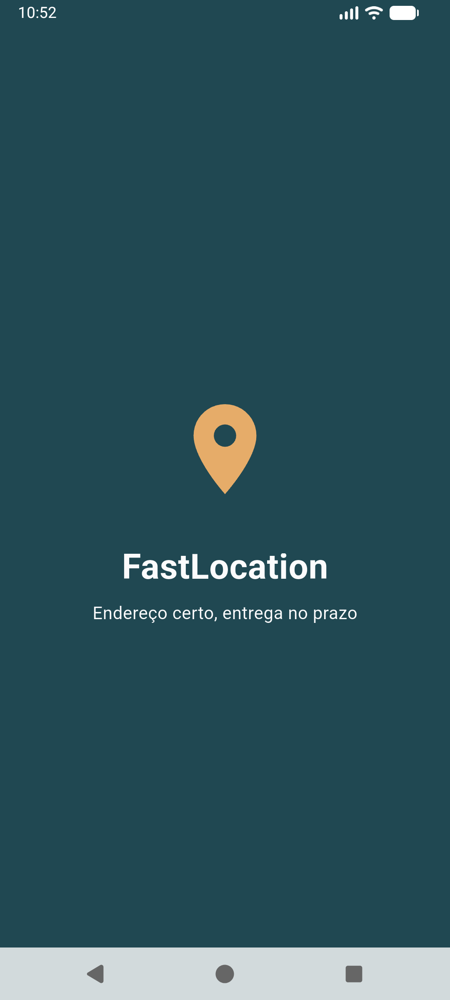
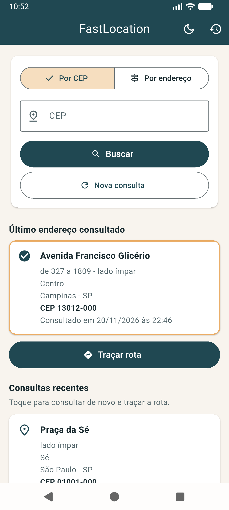
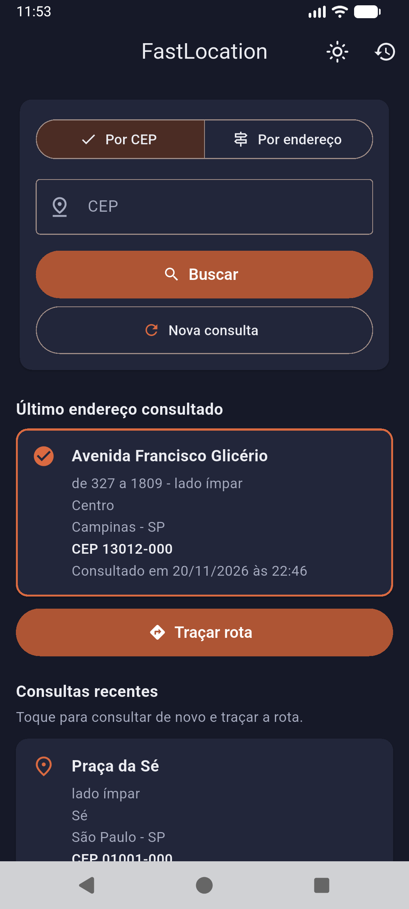
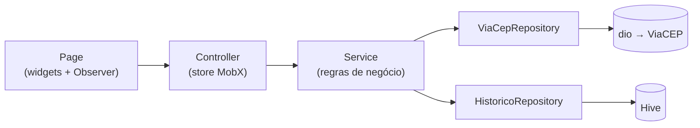

# FastLocation


App mobile para consultar **endereço por CEP** e **CEP por endereço** usando a
API pública do [ViaCEP](https://viacep.com.br/), guardar o histórico de
consultas no aparelho e abrir a **rota até o endereço** no app de mapas
instalado.

Projeto desenvolvido como o **Desafio 2 da disciplina de Desenvolvimento de
Sistemas Móveis** (Análise e Desenvolvimento de Sistemas, UniSENAI/SC).

<p align="center">
  
  
  
  
</p>

## Sumário

- [Funcionalidades](#funcionalidades)
- [Tecnologias](#tecnologias)
- [Arquitetura](#arquitetura)
- [Como executar](#como-executar)
- [Testes](#testes)
- [Decisões e desvios da especificação](#decisões-e-desvios-da-especificação)
- [Limitações conhecidas](#limitações-conhecidas)
- [Créditos](#créditos)

## Funcionalidades

- **Busca por CEP:** aceita só dígitos (8) e mostra logradouro, complemento,
  bairro, cidade/UF e CEP formatado.
- **Busca por endereço:** UF, cidade e logradouro. A API devolve uma lista;
  o usuário escolhe o endereço certo e só ele entra no histórico.
  - Vírgula e número da casa são removidos antes da consulta
    (`Av. Francisco Glicério, 935` → `Av. Francisco Glicério`), porque o
    ViaCEP recusa a vírgula (HTTP 400) e não acha nada com o número.
  - Números que fazem parte do nome são mantidos (`Rua 25 de Março`).
- **Último endereço e consultas recentes** na tela inicial, carregados do
  armazenamento local ao abrir o app.
- **Traçar rota:** converte o endereço em coordenadas (`geocoding`) e abre o
  Google Maps ou, na falta dele, o primeiro app de mapas instalado
  (`map_launcher`).
- **Histórico completo** em tela própria: ordenado da consulta mais recente
  para a mais antiga; tocar num item volta à busca com ele selecionado, e
  "limpar" pede confirmação.
- **Tema claro e escuro** com alternância na barra superior. A escolha fica
  salva; sem escolha, o app segue o tema do aparelho.
- **Mensagens de erro específicas:** sem conexão, tempo esgotado, CEP
  inexistente, consulta inválida (com dica de correção) e serviço
  indisponível.
- **Tela de abertura animada**, com a splash nativa e o ícone do app na mesma
  identidade visual.

## Tecnologias

| Finalidade | Pacote |
|---|---|
| Interface (Material 3) | [`material_ui`](https://pub.dev/packages/material_ui) |
| Gerência de estado | [`mobx`](https://pub.dev/packages/mobx), [`flutter_mobx`](https://pub.dev/packages/flutter_mobx), [`mobx_codegen`](https://pub.dev/packages/mobx_codegen) |
| Cliente HTTP | [`dio`](https://pub.dev/packages/dio) |
| Armazenamento local | [`hive`](https://pub.dev/packages/hive), [`hive_flutter`](https://pub.dev/packages/hive_flutter), [`hive_generator`](https://pub.dev/packages/hive_generator) |
| Diretórios do aparelho | [`path_provider`](https://pub.dev/packages/path_provider) |
| Coordenadas do endereço | [`geocoding`](https://pub.dev/packages/geocoding) |
| Abertura do app de mapas | [`map_launcher`](https://pub.dev/packages/map_launcher) |
| Geração de código | [`build_runner`](https://pub.dev/packages/build_runner) |

## Arquitetura

Organização por **módulos** (uma pasta por tela) mais uma camada
**compartilhada**. Cada módulo separa responsabilidades em camadas, e as
chamadas seguem num só sentido, da tela até a fonte de dados:



```text
lib/
├── main.dart                     inicializa o Hive, abre as boxes e sobe o app
└── src/
    ├── app_widget.dart           MaterialApp, temas, rotas e rolagem
    ├── http/                     cliente dio configurado para o ViaCEP
    ├── routes/                   nomes das rotas
    ├── shared/
    │   ├── colors/               paleta, ThemeData claro/escuro e store do tema
    │   ├── components/           carregamento, feedback e botão de tema
    │   ├── metrics/              espaçamentos, raios e tamanhos
    │   └── storage/              inicialização do Hive e preferências
    └── modules/
        ├── initial/              tela de abertura
        ├── home/
        │   ├── model/            EnderecoModel (adapter Hive gerado)
        │   ├── repositories/     ViaCEP e histórico local
        │   ├── service/          validação, mensagens de erro e rota
        │   ├── controller/       HomeController (MobX)
        │   ├── components/       cards, listas e estados vazios
        │   └── page/             HomePage
        └── history/
            ├── controller/       HistoryController (MobX)
            └── page/             HistoryPage
```

**Princípios aplicados:**

- **Injeção de dependência pelo construtor:** pages recebem controllers,
  controllers recebem services e services recebem repositories. Nos testes,
  cada dependência é trocada por uma versão falsa, sem rede e sem disco.
- **Montagem das dependências num ponto só:** no app real, a cadeia
  completa (dio, Hive, repositories, service e controller) é montada pelas
  funções `criarHomeController()` e `criarHistoryController()`, no arquivo de
  cada page. Os widgets da tela usam apenas o controller.
- **Estado observável só no controller:** a page apenas desenha (`Observer`)
  e reage a eventos pontuais, como a SnackBar de erro (`reaction` com
  descarte no `dispose`).
- **Erros traduzidos no service:** as camadas de cima recebem
  `ConsultaException` ou `RotaException` com mensagem pronta para o usuário,
  nunca um `DioError` cru.
- **Cores pelo tema ativo:** os componentes leem as cores do `Theme`
  (`ColorScheme` + `ThemeExtension`), não de constantes fixas. Trocar o tema
  não exige mudar nenhum componente.

## Como executar

### Pré-requisitos

| Ferramenta | Versão usada |
|---|---|
| Flutter | 3.50.0 (canal stable) |
| Dart | 3.14.0 |
| JDK | 21 (o que acompanha o Android Studio) |
| Android SDK | compileSdk/targetSdk definidos pelo Flutter 3.50 |
| Dispositivo | emulador ou aparelho Android; Xcode para iOS (somente macOS) |

Confira o ambiente com:

```bash
flutter doctor
```

### Passo a passo

```bash
git clone https://github.com/AmandaPardinho/desafio-2-mobile.git
cd desafio-2-mobile

flutter pub get
dart run build_runner build --delete-conflicting-outputs
flutter run
```

Os arquivos `*.g.dart` (stores MobX e adapter do Hive) são gerados pelo
`build_runner`. Rode o comando de novo sempre que alterar um controller com
anotações do MobX ou o `EnderecoModel`.

### Gerar o APK

```bash
flutter build apk --release
```

O arquivo sai em `build/app/outputs/flutter-apk/app-release.apk`.

## Testes

```bash
flutter analyze
flutter test
```

Situação atual: **124 testes passando** e `flutter analyze` sem nenhum
apontamento.

| Camada | O que é verificado |
|---|---|
| Model | conversão do JSON do ViaCEP, detecção do `"erro"` (booleano ou texto), formatação e compatibilidade com registros antigos do Hive |
| Repositories | URLs montadas, respostas reais gravadas em `test/fixtures/` e operações no Hive |
| Services | validações, limpeza do logradouro, mensagens por tipo de falha e abertura da rota |
| Controllers | transições de estado, cliques repetidos durante o carregamento e erros de rede ou de disco |
| Pages | fluxo completo na tela, botão voltar, SnackBars, tema e rolagem |
| Tema | contraste de cada combinação texto/fundo nos dois temas (WCAG AA, 4,5:1), inclusive o botão principal renderizado de verdade |
| Integração | `AppWidget` com as camadas reais (pages, controllers, services, repositories, `dio` e uma box do Hive em memória); simulados só a resposta HTTP, a geocodificação e o app de mapas. Fluxo: abertura → busca por CEP → gravação no histórico → rota → tela de histórico → app montado de novo mostrando o último endereço sem nova requisição |
| Persistência | gravação em disco e reabertura da box do Hive, inclusive registros salvos pela versão anterior do model |

As chamadas HTTP nos testes passam por um adaptador falso do `dio`
(`test/fakes/`); nenhum teste acessa a internet.

## Decisões e desvios da especificação

### Bibliotecas: versões ajustadas

As bibliotecas foram instaladas nas versões do enunciado. Duas delas impediam
o app de compilar no Android com o Flutter 3.50 e foram atualizadas para a
**menor versão que compila**:

| Biblioteca | Enunciado | Usada | Erro com a versão do enunciado |
|---|---|---|---|
| `map_launcher` | `^2.2.1+1` | `^4.0.0` | 2.x: `Namespace not specified` (não declara `namespace`, exigido pelo Android Gradle Plugin 8). 3.x: já declara `namespace`, mas a 3.5.0 (a que `^3.0.0` resolve) usa `compileSdkVersion 33` e falha no `:map_launcher:checkDebugAarMetadata`. A 4.0.0 é a primeira com `compileSdk = 35` |
| `geocoding` | `^2.1.1` | `^4.0.0` | `^2.1.1` resolve para a 2.2.2, que (como a 3.x) puxa o `geocoding_android` 3.x, com `compileSdk 33`, que falha no `:geocoding_android:checkDebugAarMetadata`. A 4.0.0 é a primeira que puxa o `geocoding_android` 4.x, com `compileSdk 35` |

O erro de `checkDebugAarMetadata` vem de AARs do AndroidX que exigem
compilar contra o Android 34 ou mais: `androidx.fragment:fragment:1.7.1`,
`androidx.activity:activity:1.8.1`, `androidx.window:window:1.2.0` e
`androidx.window:window-java:1.2.0`. O `compileSdk` de cada versão foi
conferido no `android/build.gradle` do pacote publicado no pub.dev.

As demais seguem o enunciado.

### Material

O app importa `package:material_ui/material_ui.dart`, e não
`package:flutter/material.dart`, porque, no Flutter 3.50, o `flutter analyze`
marca este último como *deprecated* (`deprecated_member_use`: "deprecated
after v3.47.0-0.0.pre"). O `material_ui` é a biblioteca Material oficial,
publicada pelo time do Flutter em `flutter/packages`.

### Comportamento do ViaCEP tratado no app

| Situação | Resposta da API | Tratamento |
|---|---|---|
| CEP com formato válido, mas inexistente | HTTP 200 com `{"erro": "true"}` (texto, não booleano) | tela "Nenhum endereço encontrado"; nada entra no histórico |
| Logradouro com vírgula | HTTP 400 | a vírgula e o que vem depois são removidos antes da busca |
| Logradouro com número da casa | HTTP 200 com lista vazia | o número final é removido antes da busca |
| Cidade ou logradouro com menos de 3 letras | HTTP 400 | validado no app antes de chamar a API |

### Outras decisões

- **O histórico guarda só o endereço escolhido.** Na busca por endereço,
  salvar a lista inteira enchia o histórico de ruas que o usuário não
  procurou.
- **Uma entrada por CEP.** Consultar o mesmo CEP de novo atualiza a data em
  vez de duplicar o registro.
- **Botões principais do tema escuro em `#AE5534`**, um tom mais fechado do
  Red Damask (`#DA6A41`). Texto branco sobre o Red Damask original dá 3,43:1,
  abaixo dos 4,5:1 do WCAG AA para o rótulo de 16 sp; no tom fechado, dá
  5,06:1. O Red Damask original continua nos detalhes: bordas, ícones, pin e
  card selecionado. Todos os textos, nos dois temas, passam de 4,5:1.

## Limitações conhecidas

- **iOS não foi executado.** O projeto foi desenvolvido em Linux, sem Xcode.
  A configuração de iOS está pronta (ícones sem transparência e
  `LSApplicationQueriesSchemes` para os apps de mapa), mas não foi testada em
  simulador nem em aparelho.
- **Avisos que não impedem o build:**
  - O `dio` 4.x tem 2 alertas de segurança no pub.dev, corrigidos na 5.x. Ele
    ficou na versão do enunciado.
  - O `path_provider_ios` está descontinuado; o `path_provider` atual já cobre
    o iOS. Também ficou na versão do enunciado.
  - O build avisa que o `map_launcher` usa o Kotlin Gradle Plugin, que versões
    futuras do Flutter vão recusar.
- **A busca por endereço depende da grafia do ViaCEP.** A API compara nomes
  de logradouro; abreviações muito diferentes do cadastro dos Correios podem
  não retornar resultados.

## Créditos

- Endereços fornecidos pelo [ViaCEP](https://viacep.com.br/).
- Ícone do app desenhado a partir do símbolo `location_on` dos
  [Material Icons](https://fonts.google.com/icons) (licença Apache 2.0). O
  arquivo-fonte está em [`design/icone.svg`](design/icone.svg).
